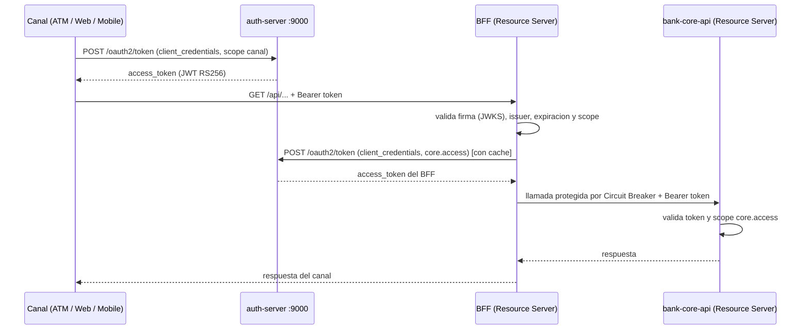

# Diagrama de Arquitectura - Banco XYZ
## Exp3 - Semana 8

```mermaid
flowchart LR

    C[Clientes]
    AUTH[Auth Server<br/>OAuth 2.0 :9000<br/>JWT RS256 / JWKS]

    WEB[BFF Web<br/>Resource Server :8081<br/>scope web.access]
    MOB[BFF Mobile<br/>Resource Server :8082<br/>scope mobile.access]
    ATM[BFF ATM<br/>Resource Server :8083<br/>scope atm.access]

    RES[Resilience4j<br/>Circuit Breaker coreApi<br/>Retry + Bulkhead + timeouts]
    CORE[Bank Core API<br/>Resource Server :8080<br/>scope core.access]
    DB[(MySQL<br/>banco_xyz_core)]

    CONFIG[Config Server<br/>:8888]
    EUREKA[Eureka Discovery Server<br/>:8761]

    KAFKA[(Apache Kafka<br/>:9092)]
    TOPIC[banco.movimientos<br/>3 particiones<br/>Key: cuentaId]
    AUD1[Audit Service - Instancia 1<br/>Consumer Group:<br/>banco-auditoria]
    AUD2[Audit Service - Instancia 2<br/>Consumer Group:<br/>banco-auditoria]

    EV1[DEPOSITO_REALIZADO]
    EV2[RETIRO_REALIZADO]
    EV3[COMPRA_REALIZADA]

    C -. 1. token client_credentials .-> AUTH
    C --> WEB
    C --> MOB
    C --> ATM

    WEB --> RES
    MOB --> RES
    ATM --> RES
    RES --> CORE

    AUTH -. JWKS: validación de firma .-> WEB
    AUTH -. JWKS .-> MOB
    AUTH -. JWKS .-> ATM
    AUTH -. JWKS .-> CORE

    CORE --> DB

    CONFIG -. configuración .-> CORE
    CORE -. registro / heartbeat .-> EUREKA

    CORE -->|AFTER_COMMIT| KAFKA
    KAFKA --> TOPIC

    EV1 --> TOPIC
    EV2 --> TOPIC
    EV3 --> TOPIC

    TOPIC --> AUD1
    TOPIC --> AUD2
```

## Flujo principal

```text
Cliente
  ↓
BFF
  ↓
Bank Core API
  ↓
MySQL
  ↓
COMMIT exitoso
  ↓
Evento interno
  ↓
KafkaMovimientoPublisher
  ↓
banco.movimientos
  ↓
Audit Service
```

## Tópico y eventos

**Tópico:**

```text
banco.movimientos
```

**Particiones:**

```text
3
```

**Key:**

```text
cuentaId
```

**Eventos:**

```text
DEPOSITO_REALIZADO
RETIRO_REALIZADO
COMPRA_REALIZADA
```

## Escalabilidad

```text
Consumer Group: banco-auditoria

Consumidor 1 -> particiones 0 y 1
Consumidor 2 -> partición 2
```

Kafka realiza automáticamente el rebalanceo cuando una nueva instancia de `audit-service` entra o sale del grupo.

## Resiliencia

```text
BFF ATM / BFF Web / BFF Mobile
  ↓
Resilience4j (coreApi)
  ↓
Bank Core API
  ↓
Resilience4j (kafkaPublisher)
  ↓
Kafka
```

Estados del Circuit Breaker:

```text
CLOSED -> OPEN -> HALF_OPEN -> CLOSED
```

Cuando el Core API no está disponible:

```text
HTTP 503
CORE_NO_DISPONIBLE
```

Cuando Kafka no está disponible, el Core registra `Kafka no disponible: evento ... no publicado`. La publicación se hace en un hilo propio, por lo que el retiro sigue respondiendo con éxito (HTTP 200).

## Contrato e idempotencia

```text
Core API -> valida JSON Schema v1 -> Kafka -> audit-service
                                             -> valida JSON Schema v1
                                             -> eventId ya visto? -> omitir (duplicado)
                                             -> procesar
```

## Servicios de soporte

```text
Config Server :8888
Eureka        :8761
Auth Server   :9000
Kafka         :9092
MySQL         :3307 (host)
Core API      :8080
BFF Web       :8081
BFF Mobile    :8082
BFF ATM       :8083
```

## Seguridad OAuth 2.0 (Semana 8)



## Despliegue con Docker Compose

```text
red banco-net
 ├─ mysql, kafka                                   (infraestructura)
 ├─ config-server, discovery-server, auth-server   (plataforma)
 ├─ bank-core-api                                  (depende de mysql, kafka, config, discovery y auth)
 ├─ bff-web / bff-mobile / bff-atm                 (dependen de bank-core-api y auth-server)
 └─ audit-service-1 / audit-service-2              (dependen de kafka, grupo banco-auditoria)
```
